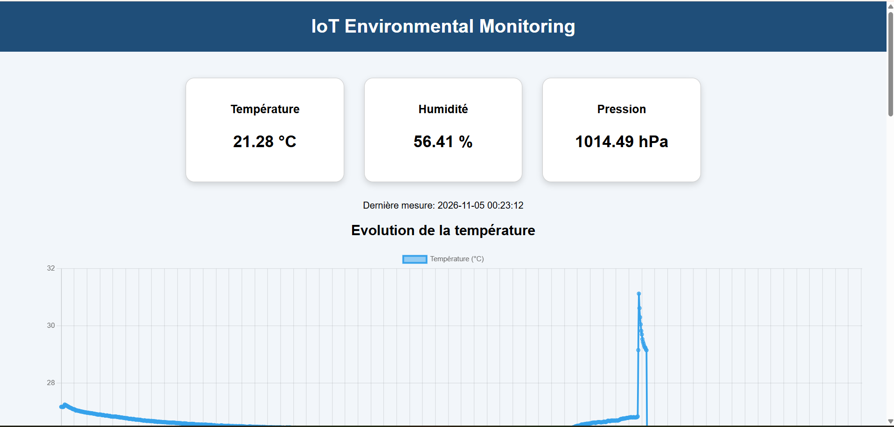
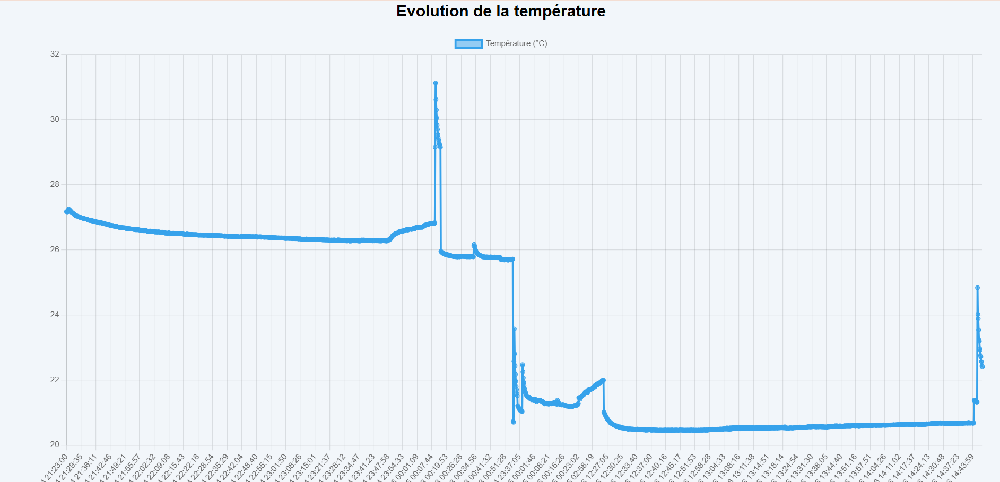
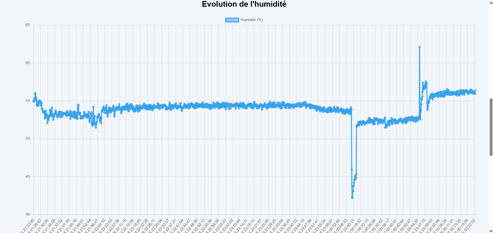
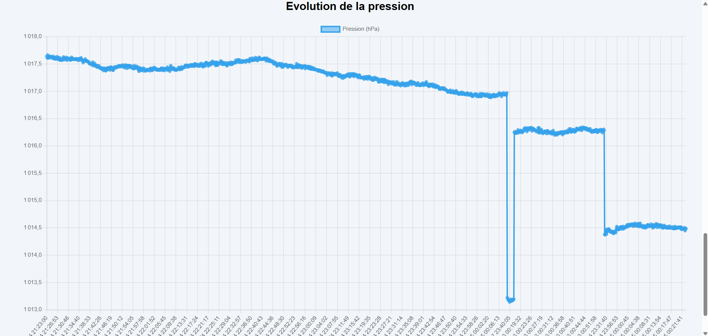
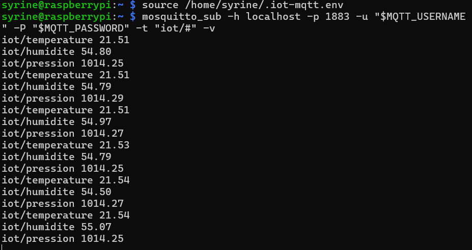
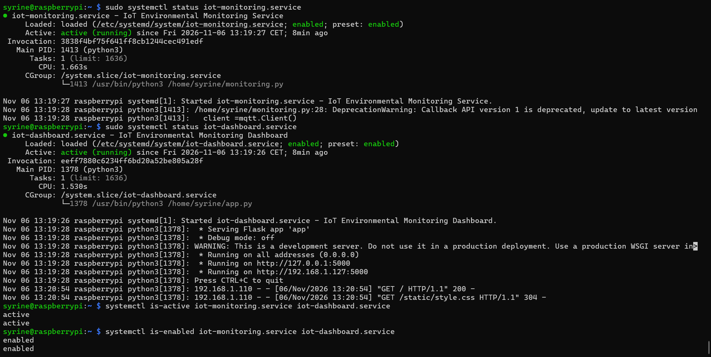

# IoT Environmental Monitoring System

## Description

This project is an IoT-based environmental monitoring system developed using a Raspberry Pi 5 and a BME280 sensor.

It collects temperature, humidity and atmospheric pressure data, stores measurements in an SQLite database, and publishes sensor data through an authenticated MQTT connection.

A Flask web dashboard provides access to environmental measurements and historical data visualization..

## Features

- Environmental data acquisition using a BME280 sensor.
- I2C communication with Raspberry Pi 5.
- Data storage using SQLite.
- Web dashboard developed with Flask, HTML, CSS and JavaScript.
- Historical data visualization using charts.
- Temperature threshold alerts.
- MQTT communication using Mosquitto with authentication.
- Automatic startup using Linux systemd services.

## Technologies

- Hardware: Raspberry Pi 5, BME280
- Programming: Python
- Database: SQLite
- Web: Flask, HTML, CSS, JavaScript
- Communication: MQTT, Mosquitto
- Operating System: Linux
- Version Control: Git, GitHub

## Architecture

See [System Architecture](docs/architecture.md).

## Project Structure

```text
iot-environment-monitoring/
├── monitoring.py
├── app.py
├── database.py
├── requirements.txt
├── templates/
├── static/
├── docs/
├── screenshots/
├── .gitignore
└── README.md
```

## Installation

1. Clone the repository.
2. Install the required Python dependencies.
3. Enable I2C on the Raspberry Pi.
4. Configure the Mosquitto MQTT broker and authentication.
5. Configure the MQTT environment variables.
6. Initialize the database.
7. Configure the systemd services.

For detailed installation and configuration instructions,
see the [Deployment Guide](docs/deployment.md).

## Project Status

Core monitoring, database storage, dashboard visualization, authenticated MQTT communication and automatic startup using systemd have been implemented and tested.
## Dashboard Preview

The web dashboard displays real-time environmental measurements and historical charts.






## MQTT Communication

The system publishes environmental measurements through authenticated MQTT communication.



## System Services

The monitoring script and web dashboard are configured as Linux systemd services for automatic startup.



## Documentation

- [System Architecture](docs/architecture.md)
- [Deployment Guide](docs/deployment.md)

## Security

MQTT credentials are stored in environment variables and are not included in the Git repository.
## Key Skills Demonstrated

- Embedded Linux and Raspberry Pi configuration.
- Python programming and sensor data acquisition.
- I2C communication protocol.
- MQTT communication and authentication.
- SQL database management.
- Web development with Flask.
- Linux service management using systemd.
- Git and GitHub version control.
## Author

Developed as a personal IoT project.

