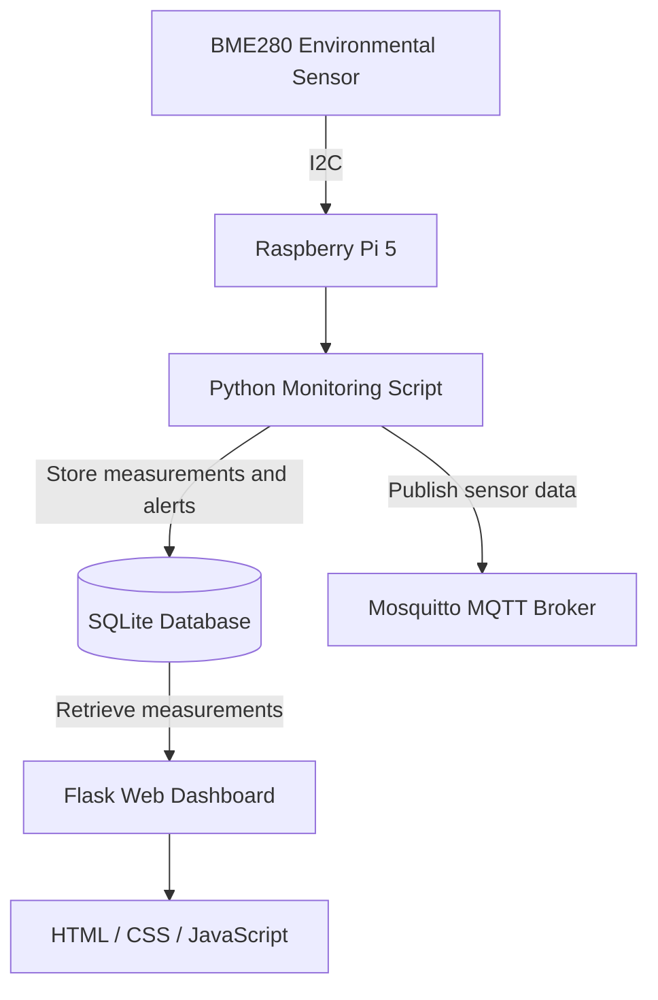

# IoT System Architecture

This diagram illustrates the architecture of the IoT Environmental Monitoring System.

## Architecture Components

- **BME280:** Measures temperature, humidity and atmospheric pressure.
- **Raspberry Pi 5:** Processes sensor data.
- **Python:** Reads sensor measurements and manages data transmission.
- **SQLite:** Stores measurements and alerts.
- **Mosquitto MQTT:** Handles authenticated MQTT communication.
- **Flask:** Provides the web dashboard.
- **HTML, CSS and JavaScript:** Build the dashboard interface and visualizations.
